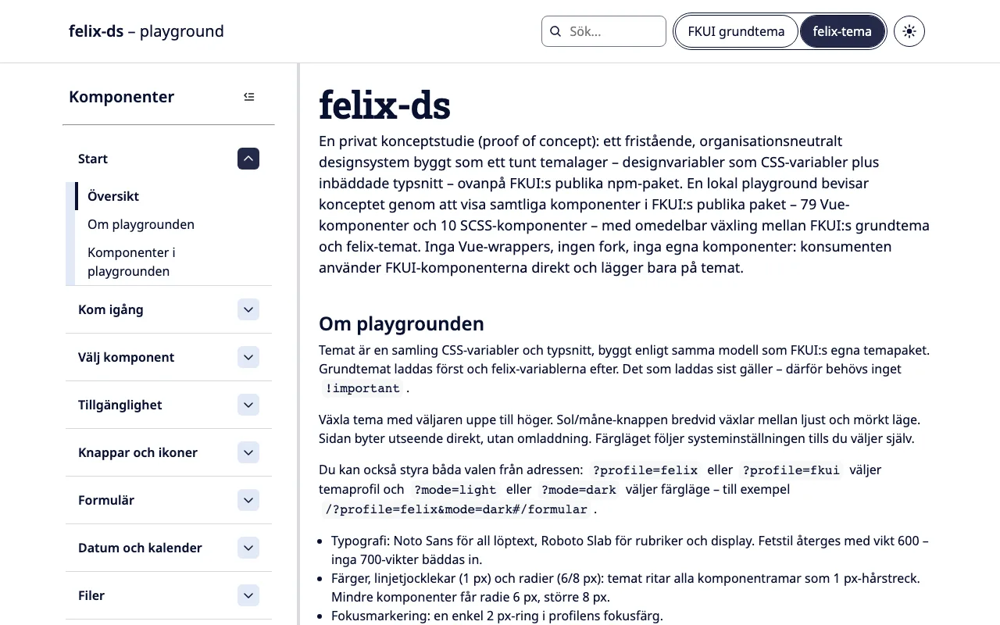
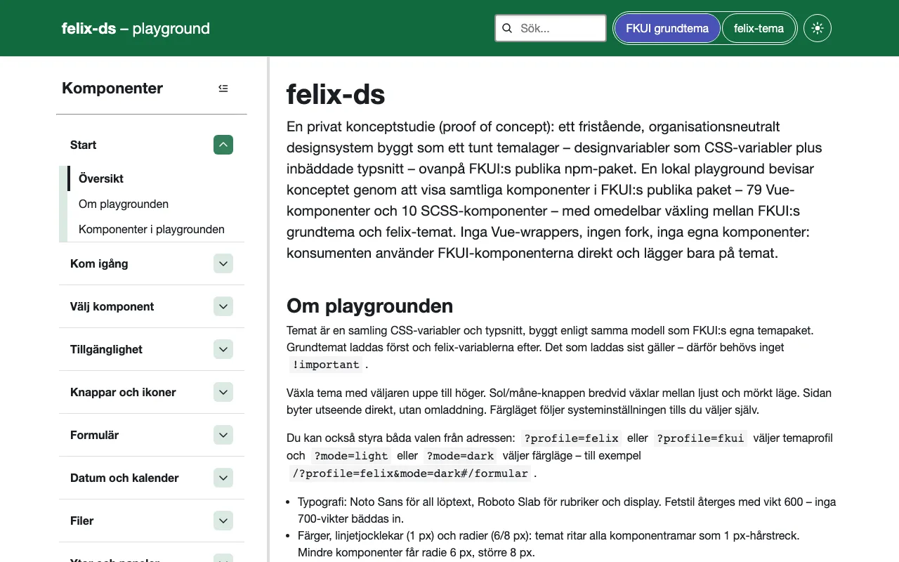

# felix-ds

*Det här dokumentet finns också på engelska: [docs/README.en.md](docs/README.en.md).*

Projektet *felix-ds* är en konceptstudie (proof of concept) – ett fristående, organisationsneutralt designsystem. Det är ett tunt temalager ovanpå [FKUI:s](https://github.com/Forsakringskassan/designsystem) publika npm-paket. Temat levererar designvariabler som CSS-variabler och inbäddade typsnitt.

Du använder FKUI-komponenterna direkt och lägger felix-temat ovanpå. felix-ds har inga Vue-wrappers, ingen fork och inga egna komponenter.

En lokal playground visar att konceptet fungerar. Alla 89 komponenter i FKUI:s publika paket finns med (79 Vue-komponenter och 10 SCSS-komponenter), och du kan växla direkt mellan FKUI:s grundtema och felix-temat.

FKUI:s dokumentation med levande komponentdemos finns på [designsystem.forsakringskassan.se](https://designsystem.forsakringskassan.se/).

## Välj ditt spår

Playgroundens startvy i de två profilerna – byt profil med `?profile=felix` eller `?profile=fkui` i adressen, eller med väljaren uppe till höger:

| felix-profilen | FKUI:s grundtema |
| --- | --- |
|  |  |

| Du vill … | Gå till |
| --- | --- |
| använda felix-temat i din egen webbapp | [Installation i en webbapp](#installation-i-en-webbapp) |
| testa playgrounden på GitHub Pages | [Känn på playgrounden](https://pattespatte.github.io/felix-ds/) |
| köra playgrounden på din dator, utforska komponenterna eller utveckla temat | [Kom igång med playgrounden](docs/development.sv.md#kom-igång-med-playgrounden) |
| se ett färdigt exempel på en webbapp med felix-temat | [Exempelsidan](https://pattespatte.github.io/felix-ds-demo-site/) |

Skillnaden mellan att installera temat i din egen webbapp och att köra playgrounden på din dator:

- **Installation i en webbapp** lägger temat som ett npm-beroende i *ditt eget projekt*. Du klonar inte något repo och du kör inte playgrounden.
- **Kom igång med playgrounden** klonar *felix-ds-repot* och startar demoappen lokalt. Du gör det för att utforska eller utveckla temat, inte för att bygga en egen webbapp.

## Installation i en webbapp

Följ det här avsnittet när du vill använda felix-temat i din egen webbapp. Du installerar temat som ett npm-beroende. Playgrounden behöver du inte för det.

Installationen går på en av tre vägar – välj en och hoppa över de andra:

| Alternativ | Passar när |
| --- | --- |
| [1: Hela paketet](#alternativ-1-hela-paketet) | din webbapp använder FKUI:s Vue-komponenter (rekommenderas) |
| [2: Bara CSS](#alternativ-2-bara-css) | du använder inte Vue-komponenterna alls |
| [3: Git-pin](#alternativ-3-git-pin) | du vill låsa mot en exakt commit, utan token |

Varje alternativ avslutas med en Klart-rad när installationen är klar. Detaljerna bakom valen står i guiden [Kom igång med felix-ds i en webbapp](docs/getting-started.sv.md).

### Alternativ 1: Hela paketet

> [!TIP]
> Rekommenderas – den här vägen passar de flesta webbappar.
>
> Paketet heter `@pattespatte/felix-ds` och publiceras på GitHub Packages med begränsad synlighet. Du behöver en personlig åtkomsttoken (PAT) med behörigheten `read:packages`, exporterad som miljövariabeln `GITHUB_PACKAGES_TOKEN` – hur du hanterar token beskrivs i [utgivningsdokumentationen](docs/release.sv.md).
>
> Kör blocket i projektroten. Det skriver `.npmrc` och installerar temat med FKUI-paketen:
>
> ```bash
> # förutsätter att GITHUB_PACKAGES_TOKEN är exporterad (PAT med read:packages)
> cat > .npmrc <<'EOF'
> @pattespatte:registry=https://npm.pkg.github.com
> //npm.pkg.github.com/:_authToken=${GITHUB_PACKAGES_TOKEN}
> EOF
> bun add @pattespatte/felix-ds
> # samma version X.Y.Z i alla @fkui/*-paket
> bun add --exact @fkui/theme-default@X.Y.Z @fkui/design@X.Y.Z @fkui/vue@X.Y.Z
> ```
>
> Har du redan en `.npmrc`? Lägg då till de två raderna i den filen i stället. Byt ut `X.Y.Z` mot den FKUI-version du väljer – playgroundens egna lås visas i [vyn Kom igång](https://pattespatte.github.io/felix-ds/#/kom-igang).
>
> Lägg till de tre raderna i appens startfil (oftast `src/main.ts`):
>
> ```ts
> import "@fkui/design/lib/fkui.css";
> import "@fkui/design/lib/fonts.css";
> import "@pattespatte/felix-ds/dist/felix.css";
> ```
>
> **Klart.** Temat och FKUI-paketen är installerade och importerna ligger i startfilen – fortsätt med [Ett första exempel](#ett-första-exempel) och se temat på plats.

### Alternativ 2: Bara CSS

Temapaketet räcker – du behöver inga `@fkui/*`-paket när du inte använder FKUI:s Vue-komponenter. Installera paketet (med samma `.npmrc`-konfiguration som i alternativ 1) och importera en förbyggd fil:

```bash
bun add @pattespatte/felix-ds
```

Lägg importen i appens startfil:

```ts
import "@pattespatte/felix-ds/dist/felix.css";
```

Välj fil efter vad du behöver:

- `dist/felix.css` – temats designvariabler och typsnitt, cirka 5 kb gzippat. Båda färglägena är inbyggda.
- `dist/felix-complete.css` – samma CSS sammanfogad med FKUI:s komponent-css och typsnitts-css, cirka 30 kb gzippat. Använd den när du skriver FKUI:s CSS-klasser utan Vue.

Bra att veta:

- Vue-komponenterna (79 av FKUI:s 89) kräver `@fkui/vue` och Vue. CSS-filerna ger designvariabler, typsnitt och FKUI:s CSS-klasser – inte de interaktiva komponenterna.
- Bun och npm löser in peer-beroendet `@fkui/theme-default` automatiskt. De förbyggda filerna läser det aldrig – det behövs bara när du kompilerar egen Sass.
- Utan byggkedja laddar du `dist/felix-complete.min.css` med ett vanligt `<link>`-element. Typsnitten ligger i `src/fonts/files/` och nås med sökvägar som är relativa till CSS-filen – kopiera med den mappen, eller skriv om `@font-face`-reglerna till egna url:er.
- Alternativ 3 fungerar också här, utan token. Importen blir då `felix-ds/dist/felix.css`.

**Klart.** Temapaketet är installerat och importen ligger i startfilen. Designvariabler, typsnitt och båda färglägena är aktiva.

### Alternativ 3: Git-pin

Du installerar direkt från det publika repot och låser mot en exakt commit – ingen token behövs. Kör i projektroten:

```bash
bun add felix-ds@github:pattespatte/felix-ds#<commit>
# samma version X.Y.Z i alla @fkui/*-paket
bun add --exact @fkui/theme-default@X.Y.Z @fkui/design@X.Y.Z @fkui/vue@X.Y.Z
```

Importerna följer paketnamnet utan scope. Lägg till raderna i appens startfil:

```ts
import "@fkui/design/lib/fkui.css";
import "@fkui/design/lib/fonts.css";
import "felix-ds/dist/felix.css";
```

FKUI-paketen behövs bara när du använder Vue-komponenterna – annars räcker första kommandot och importen `felix-ds/dist/felix.css`.

**Klart.** Temat är installerat från repot och låst mot en exakt commit, och importerna ligger i startfilen – fortsätt med [Ett första exempel](#ett-första-exempel).

### Ett första exempel

Temat syns direkt i en Vue-komponent. Rubriken får typsnittet Roboto Slab, knappen får temats färger och fokusmarkering:

```vue
<script setup lang="ts">
import { FButton } from "@fkui/vue";
</script>

<template>
    <h1>Min sida</h1>
    <f-button>Skicka in</f-button>
</template>
```

Knappen finns levande i [playgroundens knappvy](https://pattespatte.github.io/felix-ds/#/knappar/fbutton). En hel sajt med temat finns på [exempelsidan](https://pattespatte.github.io/felix-ds-demo-site/).

## Välj ett utvecklarspår att gå vidare med

- **[Kom igång med felix-ds i en webbapp](docs/getting-started.sv.md)** – steg för steg genom installationen, ikoner, mörkt läge, design tokens i DTCG-format och kompatibilitet.
- **[Utveckla felix-ds och köra playgrounden](docs/development.sv.md)** – kör playgrounden lokalt, skripten, arkitekturen, uppgradering av FKUI-beroendena och underhållsarbetena.

## Kända valideringsfynd (tredjepartskod)

<details>
<summary>Visa fynden</summary>

En HTML/CSS-validerare (till exempel W3C:s Nu-validerare) rapporterar flera fynd på playgrounden. Alla härstammar från tredjepartskod. Inget kommer från temalagrets egna filer. Vi åtgärdar dem därför inte här: projektet använder FKUI enbart som publika npm-paket (ingen fork, inga patchar), och fynden finns kvar i senaste publicerade versionen. Fynden är harmlösa i webbläsarna.

**Från FKUI:s stilmall `@fkui/design/lib/fkui.css`:**

- `padding`, `padding-top` och `padding-bottom` med `calc(var(--…, initial) * var(--f-density-factor, 1))` (6 deklarationer). Det är giltig modern CSS (math functions med `var()`). Validerarens parser stödjer den inte ännu, så det är ett falskt positivt.
- `container-type`, `@container` och `field-sizing` (4 fynd). Det är standardiserad modern CSS (container queries samt `field-sizing`, som är skyddad av `@supports`). Validerarens kunskap om egenskaper släpar efter, så det är falska positiva.
- `border-radius: var(--f-button-discrete-radius-hover, none)` (2 deklarationer). Variabeln är definierad som `none`, vilket inte är en giltig radielängd. Webbläsaren ogiltigförklarar därför deklarationen i körning. Det är en bugg i FKUI:s publicerade CSS, men den syns inte i playgrounden: knappelementets övriga regler behåller radien.
- `background-color: none` (2 deklarationer). Värdet är ogiltigt och webbläsaren stryker det. Det avsedda värdet är samma som initialvärdet (transparent), så det blir ingen visuell skillnad.
- `font-feature-settings: tnum` (1 deklaration). Funktionstaggen ska stå inom citattecken (`"tnum"`). Webbläsaren stryker den ociterade deklarationen. De andra, korrekt citerade deklarationerna i samma fil gäller.

**Från DOM som FKUI renderar:**

- `<textarea value="">`. Komponenten [FTextareaField](https://pattespatte.github.io/felix-ds/#/formular/ftextareafield) skickar med `value` som attribut, vilket HTML-specen inte tillåter på `textarea`. FKUI renderar det i körning. Vi kan inte åtgärda det utan en Vue-wrapper, och projektreglerna förbjuder wrappers.
- `<symbol x="0" y="0">`. `x` och `y` är giltiga attribut på `symbol` enligt SVG 2. Validerarens schema bygger på SVG 1.1, så det är ett falskt positivt.

**Från Vites utvecklingsläge:**

- `<style type="text/css">` (8 varningar). Dev-servern lägger in importerad CSS som style-element. Produktionsbygget länkar CSS:en med `<link>` i stället, så varningarna försvinner där. Validera därför `bun run build` följt av `bun run preview` (eller den byggda sidan), inte dev-serverns DOM.

</details>

## Licenser

- FKUI-beroendena (`@fkui/vue`, `@fkui/design`, `@fkui/theme-default`, `@fkui/date`, `@fkui/logic`, `@fkui/icon-lib-default`) har MIT-licens. Du använder dem som publika npm-paket.
- Ikonuppsättningen är renderad från Phosphor Icons (MIT-licens) via utvecklingsberoendet `@phosphor-icons/vue`.
- Noto Sans distribueras under SIL Open Font License 1.1. Licenstexten finns i `src/fonts/licenses/noto-sans-OFL.txt`.
- Roboto Slab distribueras under Apache License 2.0. Licenstexten finns i `src/fonts/licenses/roboto-slab-LICENSE-APACHE-2.0.txt`.

## Publiceringspolicy

Ägaren publicerar paketet som `@pattespatte/felix-ds` på GitHub Packages med begränsad synlighet. Den som installerar paketet behöver en PAT (Personal Access Token). Publicering sker bara enligt ägarens [utgivningsdokumentation](docs/release.sv.md). Varje utgivning passerar först den visuella porten (skärmdumpsjämförelser och axe-skanningar). Tillgänglighetstäckningen dokumenteras i [playgroundens vy Tillgänglighet](https://pattespatte.github.io/felix-ds/#/tillganglighet): vilken vy som demonstrerar varje komponent, vad axe-testningen omfattar och vad som kräver manuell granskning. Underlaget att lyfta in i en egen tillgänglighetsredogörelse finns i [docs/accessibility-basis.sv.md](docs/accessibility-basis.sv.md). Repot ligger på GitHub, och playgrounden byggs och serveras via GitHub Pages med ägarens uttryckliga godkännande.
