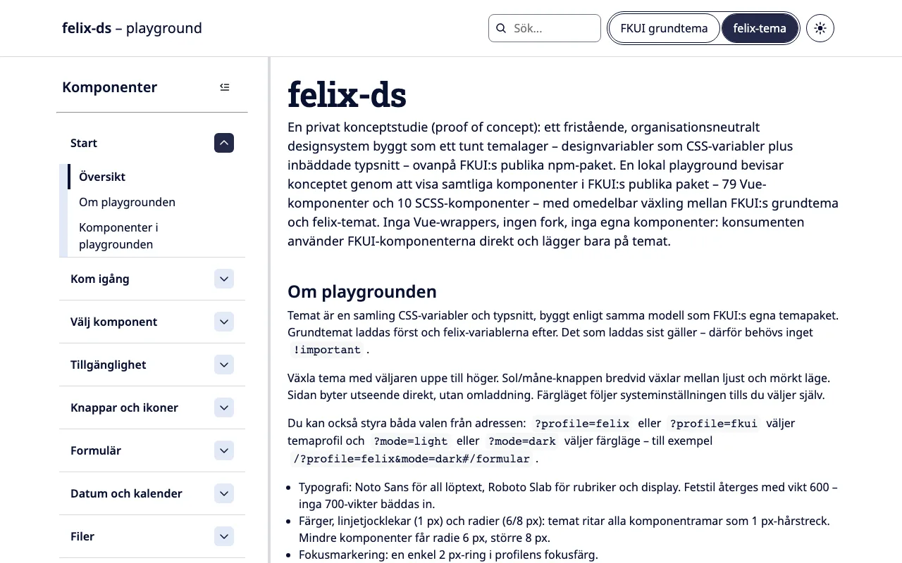
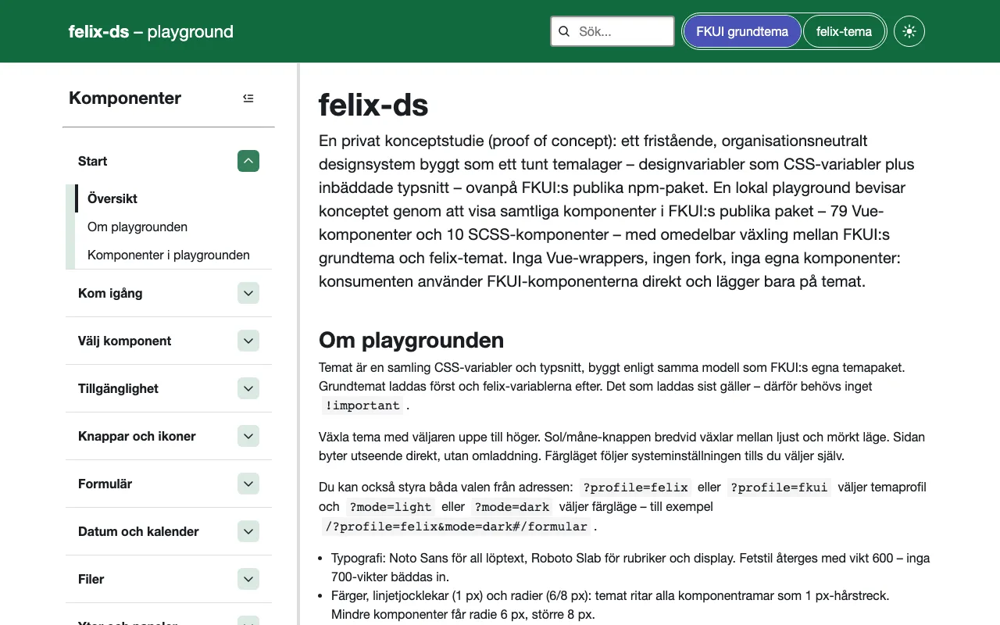

# felix-ds

*This document is also available in Swedish: [../README.md](../README.md).*

felix-ds is a proof of concept: a standalone, organization-neutral design system. It is a thin theme layer on top of [FKUI's](https://github.com/Forsakringskassan/designsystem) public npm packages. The theme delivers design tokens as CSS custom properties and self-hosted fonts.

You use the FKUI components directly and apply the felix theme on top. felix-ds has no Vue wrappers, no fork and no components of its own.

A local playground proves the concept. It shows all 89 components in FKUI's public packages (79 Vue components and 10 SCSS-only components) and lets you switch instantly between the FKUI base theme and the felix theme.

FKUI's documentation with live component demos is available at [designsystem.forsakringskassan.se](https://designsystem.forsakringskassan.se/).

## Choose your path

The playground start view in the two profiles – switch profile with `?profile=felix` or `?profile=fkui` in the address bar, or with the selector in the top right:

| The felix profile | The FKUI base theme |
| --- | --- |
|  |  |

| You want to … | Go to |
| --- | --- |
| use the felix theme in your own web app | [Installation in a web app](#installation-in-a-web-app) |
| test the playground at GitHub Pages | [Check out the playground](https://pattespatte.github.io/felix-ds/) |
| run the playground on your machine, explore the components or develop the theme | [Getting started with the playground](development.en.md#getting-started-with-the-playground) |
| see a finished example of a web app with the felix theme | [Example site](https://pattespatte.github.io/felix-ds-demo-site/) |

The difference between installing the theme in your own web app and running the playground on your machine:

- **Installation in a web app** adds the theme as an npm dependency in *your own project*. You do not clone a repo and you do not run the playground.
- **Getting started with the playground** clones the *felix-ds repo* and starts the demo app locally. You do this to explore or develop the theme, not to build your own web app.

## Installation in a web app

Follow this section when you want to use the felix theme in your own web app. You install the theme as an npm dependency. You do not need the playground for that.

Installation takes one of three routes – pick one and skip the others:

| Option | Right when |
| --- | --- |
| [1: The full package](#option-1-the-full-package) | your web app uses FKUI's Vue components (recommended) |
| [2: CSS only](#option-2-css-only) | you do not use the Vue components at all |
| [3: Git pin](#option-3-git-pin) | you want to lock to an exact commit, without a token |

Every option ends with a line telling you the installation is complete. The details behind the choices are in the guide [Get started with felix-ds in a web app](getting-started.en.md).

### Option 1: The full package

> [!TIP]
> Recommended – this route fits most web apps.
>
> The package is called `@pattespatte/felix-ds` and is published on GitHub Packages with restricted visibility. You need a personal access token (PAT) with the `read:packages` scope, exported as the environment variable `GITHUB_PACKAGES_TOKEN` – how to handle the token is described in the [release runbook](release.en.md).
>
> Run the block in your project root. It writes `.npmrc` and installs the theme with the FKUI packages:
>
> ```bash
> # requires GITHUB_PACKAGES_TOKEN to be exported (PAT with read:packages)
> cat > .npmrc <<'EOF'
> @pattespatte:registry=https://npm.pkg.github.com
> //npm.pkg.github.com/:_authToken=${GITHUB_PACKAGES_TOKEN}
> EOF
> bun add @pattespatte/felix-ds
> # the same version X.Y.Z across every @fkui/* package
> bun add --exact @fkui/theme-default@X.Y.Z @fkui/design@X.Y.Z @fkui/vue@X.Y.Z
> ```
>
> Already have an `.npmrc`? Add the two lines to that file instead. Replace `X.Y.Z` with the FKUI version you choose – the playground's own pins are shown in the Kom igång view.
>
> Add the three lines to your web app's entry point (usually `src/main.ts`):
>
> ```ts
> import "@fkui/design/lib/fkui.css";
> import "@fkui/design/lib/fonts.css";
> import "@pattespatte/felix-ds/dist/felix.css";
> ```
>
> **Done.** The theme and the FKUI packages are installed and the imports sit in your entry point – continue with [A first example](#a-first-example) and see the theme at work.

### Option 2: CSS only

The theme package is enough – you need no `@fkui/*` packages when you do not use FKUI's Vue components. Install the package (with the same `.npmrc` configuration as in option 1) and import one prebuilt file:

```bash
bun add @pattespatte/felix-ds
```

Add the import to your web app's entry point:

```ts
import "@pattespatte/felix-ds/dist/felix.css";
```

Pick the file for what you need:

- `dist/felix.css` – the theme's design tokens and fonts, about 5 KB gzipped. Both color modes are built in.
- `dist/felix-complete.css` – the same CSS concatenated with FKUI's component CSS and font CSS, about 30 KB gzipped. Use it when you write FKUI's CSS classes without Vue.

Good to know:

- The Vue components (79 of FKUI's 89) still require `@fkui/vue` and Vue. The CSS files give you the design tokens, the fonts and FKUI's CSS classes – not the interactive components.
- Bun and npm resolve the `@fkui/theme-default` peer dependency automatically. The prebuilt files never read it – it matters only when you compile your own Sass.
- Without a build chain, load `dist/felix-complete.min.css` with a plain `<link>` element. The fonts live in `src/fonts/files/` at paths relative to the CSS file – copy that folder along, or rewrite the `@font-face` rules to your own URLs.
- Option 3 works here too, without a token. The import then becomes `felix-ds/dist/felix.css`.

**Done.** The theme package is installed and the import sits in your entry point. The design tokens, the fonts and both color modes are active.

### Option 3: Git pin

You install straight from the public repo and lock to an exact commit – no token needed. Run in your project root:

```bash
bun add felix-ds@github:pattespatte/felix-ds#<commit>
# the same version X.Y.Z across every @fkui/* package
bun add --exact @fkui/theme-default@X.Y.Z @fkui/design@X.Y.Z @fkui/vue@X.Y.Z
```

The imports follow the package name without the scope. Add the lines to your web app's entry point:

```ts
import "@fkui/design/lib/fkui.css";
import "@fkui/design/lib/fonts.css";
import "felix-ds/dist/felix.css";
```

The FKUI packages matter only when you use the Vue components – otherwise the first command and the import `felix-ds/dist/felix.css` are enough.

**Done.** The theme is installed from the repo and locked to an exact commit, and the imports sit in your entry point – continue with [A first example](#a-first-example).

### A first example

The theme shows up straight away in a Vue component. The heading gets the Roboto Slab typeface, the button gets the theme's colors and focus ring:

```vue
<script setup lang="ts">
import { FButton } from "@fkui/vue";
</script>

<template>
    <h1>My page</h1>
    <f-button>Submit</f-button>
</template>
```

The button is live in the [playground's button view](https://pattespatte.github.io/felix-ds/#/knappar/fbutton). A whole site with the theme is on the [example site](https://pattespatte.github.io/felix-ds-demo-site/).

## Choose a developer track to continue with

- **[Get started with felix-ds in a web app](getting-started.en.md)** – the installation step by step, icons, dark mode, design tokens in DTCG format and compatibility.
- **[Developing felix-ds and running the playground](development.en.md)** – run the playground locally, the scripts, the architecture, upgrading the FKUI dependencies and the maintenance work.

## Known validation findings (third-party code)

<details>
<summary>Show the findings</summary>

An HTML/CSS validator (for example the W3C Nu checker) reports several findings on the playground. All of them originate in third-party code. None come from the theme layer's own files. We therefore do not fix them here: the project uses FKUI strictly as public npm packages (no fork, no patches), and the findings remain in the latest published version. The findings are harmless in browsers.

**From FKUI's stylesheet `@fkui/design/lib/fkui.css`:**

- `padding`, `padding-top` and `padding-bottom` with `calc(var(--…, initial) * var(--f-density-factor, 1))` (6 declarations). This is valid modern CSS (math functions with `var()`). The validator's parser does not support it yet, so this is a false positive.
- `container-type`, `@container` and `field-sizing` (4 findings). This is standardized modern CSS (container queries, and `field-sizing`, which is guarded by `@supports`). The validator's property knowledge lags behind, so these are false positives.
- `border-radius: var(--f-button-discrete-radius-hover, none)` (2 declarations). The variable is defined as `none`, which is not a valid radius length. The browser therefore invalidates the declaration at runtime. This is a bug in FKUI's published CSS, but it has no visible effect in the playground: the button element's other rules keep the radius.
- `background-color: none` (2 declarations). The value is invalid and browsers drop it. The intended value equals the initial value (transparent), so there is no visual difference.
- `font-feature-settings: tnum` (1 declaration). The feature tag must be quoted (`"tnum"`). Browsers drop the unquoted declaration. The other, correctly quoted declarations in the same file apply.

**From DOM that FKUI renders:**

- `<textarea value="">`. The [FTextareaField](https://pattespatte.github.io/felix-ds/#/formular/ftextareafield) component passes `value` as an attribute, which the HTML spec does not allow on `textarea`. FKUI renders it at runtime. We cannot fix it without a Vue wrapper, and the project rules forbid wrappers.
- `<symbol x="0" y="0">`. `x` and `y` are valid attributes on `symbol` per SVG 2. The validator's schema is based on SVG 1.1, so this is a false positive.

**From Vite's development mode:**

- `<style type="text/css">` (8 warnings). The dev server injects imported CSS as style elements. The production build links the CSS with `<link>` instead, so the warnings disappear there. Validate `bun run build` followed by `bun run preview` (or the built site), not the dev server's DOM.

</details>

## Licenses

- The FKUI dependencies (`@fkui/vue`, `@fkui/design`, `@fkui/theme-default`, `@fkui/date`, `@fkui/logic`, `@fkui/icon-lib-default`) are MIT licensed. You use them as public npm packages.
- The icon set is rendered from Phosphor Icons (MIT licensed) via the `@phosphor-icons/vue` dev dependency.
- Noto Sans is distributed under the SIL Open Font License 1.1. The license text is in `src/fonts/licenses/noto-sans-OFL.txt`.
- Roboto Slab is distributed under the Apache License 2.0. The license text is in `src/fonts/licenses/roboto-slab-LICENSE-APACHE-2.0.txt`.

## Publishing policy

The owner publishes the package as `@pattespatte/felix-ds` on GitHub Packages with restricted visibility. Anyone who installs the package needs a PAT (personal access token). Publishing follows only the owner's [release runbook](release.en.md). Every release first passes the visual gate (screenshot comparisons and axe scans). Accessibility coverage is documented in the playground's Tillgänglighet view: which view demonstrates each component, what the axe testing covers and what requires manual review. A lift-ready basis for your own accessibility statement is in [docs/accessibility-basis.en.md](accessibility-basis.en.md). The repo is on GitHub, and the playground is built and served via GitHub Pages with the owner's explicit approval.
