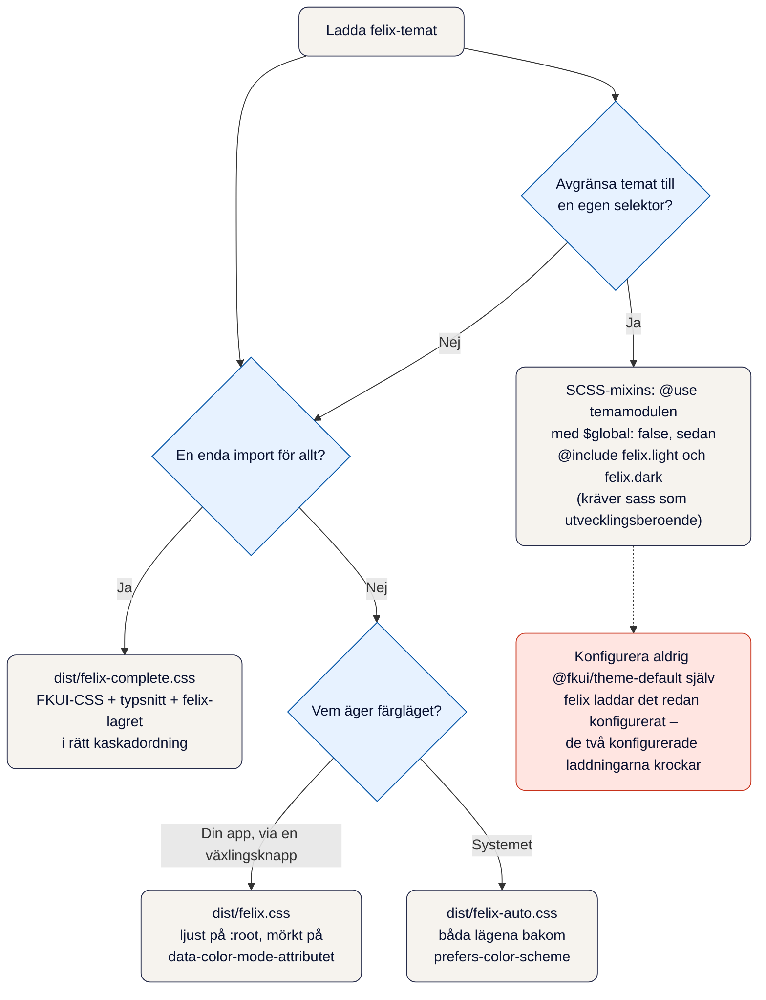

# Skapa en webbplats med felix-ds

Den här guiden beskriver hur man bygger en komplett webbplats på felix-ds – FKUI:s publika npm-paket med felix-temat ovanpå. Den är skriven efter det mönster som bevisats på en fullständig demosajt (Vue 3 + TypeScript + Vite, 26 rutter, sök, prerendering och både ljust och mörkt läge), inte spekulativt.

Ett levande exempel på allt nedan finns i demosajten som konsumerar felix-ds som npm-beroende från GitHub Packages.

## Förutsättningar

- Bun (pakethanterare och skriptkörare – npm fungerar som reserv)
- Node.js i aktuell version
- Grundläggande vana vid Vue 3 med `<script setup lang="ts">`, Vue Router och Vite

## Sätt upp projektet

Skapa ett Vue 3-projekt och lägg till beroendena nedan. Exemplen i guiden använder Vite med vue-ts-mallen, men felix-ds och FKUI fungerar med vilken byggverktygskedja som helst.

```bash
bun add vue vue-router@^4
bun add @fkui/vue@6.60.0 @fkui/design@6.60.0 @fkui/theme-default@6.60.0 @fkui/date@6.60.0 @fkui/logic@6.60.0 @fkui/icon-lib-default@6.60.0
bun add -d vite @vitejs/plugin-vue typescript vue-tsc @types/node
```

Sass behövs inte för temat – det konsumeras som förbyggd CSS. Lägg till `sass` bland utvecklingsberoendena först om du skriver egen SCSS. Se [Temaintegration](#temaintegration).

felix-ds installeras på två sätt – registerversionen är huvudspåret:

**Väg A – register (huvudspår).** Paketet publiceras som `@pattespatte/felix-ds` på GitHub Packages med begränsad synlighet. Det kräver en personlig åtkomsttoken (PAT) med `read:packages`, exporterad som miljövariabeln `GITHUB_PACKAGES_TOKEN` (tokenhanteringen beskrivs i [utgivningsdokumentationen](./release.sv.md)). Kör blocket nedan i projektroten – det skriver `.npmrc` och installerar paketet. Har du redan en `.npmrc`, lägg de två raderna i den i stället:

```bash
# förutsätter att GITHUB_PACKAGES_TOKEN är exporterad (PAT med read:packages)
cat > .npmrc <<'EOF'
@pattespatte:registry=https://npm.pkg.github.com
//npm.pkg.github.com/:_authToken=${GITHUB_PACKAGES_TOKEN}
EOF
bun add @pattespatte/felix-ds
```

**Väg B – git-pin (före 1.0.0 och för låsning mot en specifik commit).** Installerar direkt från det publika repot:

```bash
bun add felix-ds@github:pattespatte/felix-ds#<commit>
```

Fyra saker är värda att känna till:

- **FKUI-paketen låses exakt.** Alla sex `@fkui/*`-paket låses till samma exakta version, i takt med hur uppströms publicerar dem. felix-ds stödjer `@fkui/theme-default` inom intervallet `>=6.57.0 <7.0.0` (se kompatibilitetsavsnittet i temarepots README) – lås senaste versionen inom intervallet.
- **Modulspecificeraren följer paketnamnet.** Väg A ger `@pattespatte/felix-ds/src/...` i `@use` och importvägar, väg B ger `felix-ds/src/...`. I övrigt är guiden identisk mellan vägarna.
- **Peka på en specifik commit, inte en gren** (väg B), så att bygget blir identiskt lokalt och i CI.
- **Både förbyggd CSS och SCSS följer med.** `dist/felix.css` och `dist/felix-auto.css` är färdigkompilerade och kräver ingen Sass. SCSS-källorna under `src/` behövs bara för att avgränsa temat till en egen selektor (se nästa avsnitt).

I `vite.config.ts` behövs två saker utöver vue-pluginen: ett `@`-alias till `./src` och `isCustomElement: (tag) => tag.startsWith("ce-")`, eftersom FKUI registrerar sina egna custom elements (ce-page-layout med flera) i runtime.

## Temaintegration



I den fil där appen startar (i ett Vite- och Vue-projekt oftast `src/main.ts`) laddar du FKUI:s komponent-CSS först:

```ts
import "@fkui/icon-lib-default/dist/f";
import "@fkui/design/lib/fkui.css";
import "@fkui/design/lib/fonts.css";
import "felix-ds/dist/felix.css";
import "./assets/main.css";
import "./fkui-patches";
```

Temat appliceras med den förbyggda posten `dist/felix.css` – ingen Sass behövs. Filen innehåller `@font-face`, det ljusa temat på `:root` och det mörka temat på `html[data-color-mode="dark"]`. Varje scope skriver ut den kompletta tokensytan och specificitetsstegen (`:root` (0,1,0) < `html[data-color-mode="dark"]` (0,1,1)) löser båda lägena utan `!important`. Vill du följa systeminställningen i stället för att styra färgläget själv, använd `dist/felix-auto.css` (båda temana bakom `prefers-color-scheme`).

Föredrar du en enda temaimport? `dist/felix-complete.css` sammanfogar `@fkui/design` komponent-css, teckensnittsregeln och felix-lagret i samma kaskadordning som de tre mellersta raderna ovan – en valfri bekvämlighet, inte standarden:

```ts
import "@fkui/icon-lib-default/dist/f";
import "felix-ds/dist/felix-complete.css";
import "./assets/main.css";
import "./fkui-patches";
```

Behöver du avgränsa temat till en egen selektor? Då använder du SCSS-mixinerna i stället, och projektet behöver då `sass` som utvecklingsberoende:

```scss
@use "felix-ds/src/fonts/fonts";
@use "felix-ds/src/theme/default" as felix with (
    $global: false
);

:root {
    @include felix.light;
}

html[data-color-mode="dark"] {
    @include felix.dark;
}
```

Den globala `@use "felix-ds/src/index"` skriver bara ut det ljusa temat på `:root` – den kan inte uttrycka det attributstyrda mörka scopet och passar bara helt ljusa sajter. Mixinerna `felix.light` och `felix.dark` deklarerar dessutom `color-scheme` per läge, så nativa kontroller och rullistor följer med automatiskt – den förbyggda filen innehåller samma deklarationer. Konfigurera aldrig `@fkui/theme-default` själv i din app – felix-modulen konfigurerar redan sin egen laddning av den, och en dubbel konfiguration kolliderar.

Egen layout-css skrivs med tokens endast – `--fkds-*` och `--f-*` – utan råa hexvärden. Då växlar varje egen yta (kort, paneler, tabellränder) med färgläget gratis, och kontrasten i mörkt läge behöver aldrig lagas för hand. Dimensioner (marginaler, brytpunkter) är förstås vanliga remvärden.

## Typsnitt

Alla typsnitt följer med temat: Noto Sans för brödtext (400, 600 + kursiv) och Roboto Slab för rubriker, med fet stil mappad på vikt 600. Den förbyggda `dist/felix.css` innehåller @font-face-reglerna med woff2-referenser som Vite bundlar (SCSS-flödet får samma regler via `@use "felix-ds/src/fonts/fonts"`) – inga CDN-anrop, inga Google Fonts, ingen integritetsgranskning. Kontrollera gärna i bygget att `dist/assets/*.woff2` finns och att ingen `fonts.googleapis.com`-referens smugit sig in.

## Mörkt läge

Mönstret har tre delar som samverkar:

1. **En färgmodul** (`color-mode.ts`) äger läget: den följer `prefers-color-scheme` tills användaren väljer explicit, sparar valet i localStorage under en egen nyckel, sätter eller tar bort `data-color-mode="dark"` på `<html>` och lyssnar på systembyten så länge inget explicit val finns.
2. **Ett inline-skript i `<head>`** kör samma logik innan sidan ritas första gången, så den aldrig blinkar i fel läge. Skriptet upprepar modulens läsning av localStorage – håll nyckeln synkroniserad.
3. **En växlingsknapp** i sidhuvudet anropar modulens toggle. Sol- och månsymbolerna får du rita själv – standardbiblioteket har inga sådana ikoner.

Vänta dig att de förrenderade sidorna är ljusa: den statiska HTML:en byggs i ljust läge och inline-skriptet applicerar mörkt vid besök. Det är avsiktligt och räcker för en demo. En tjänst med krav på förrenderade sidor i mörkt läge behöver köra prerender i båda lägena.

## Ikoner

`@fkui/icon-lib-default` innehåller 31 ikoner (alert, arrow-down, arrow-in-circle, arrow-right, bars, bell, calendar, caret-down, caret-up, chevrons-left, circle, circle-notch-solid, close, cross, dash, doc, ellipsis, error, file, i, new-window, paper-clip, pdf, pen, pic, plus, search, sort, success, trashcan, triangle). Importera biblioteket en gång i appens startfil och rendera med `<f-icon name="...">`.

Ett rikt ikonbibliotek (Phosphor med flera) har ingen motsvarighet här – välj ikon efter betydelse i varje användningsfall (kalender → calendar, sök → search, läkare/vård → cross) och låt dekorativa ikoner utan motsvarighet bli text i stället för att ge fel betydelse. Ikonnamnet måste vara exakt: ett ogiltigt namn renderar tomt.

## Komponenter och layout

Några mönster som demosajten bevisat:

- **Navigeringsmeny med SPA-routing.** `FNavigationMenu` renderar ankare och dokumenterar själv mönstret: skicka rutter utan `href`, lyssna på `@selected-route` och anropa `router.push(key)`. Annars laddar webbläsaren om hela sidan vid history-routing. Den vertikala varianten (`vertical`) passar sekundärnavigering.
- **Rullgardinsmenyer.** `FContextMenu` är FKUI:s popup-meny: en knapprubrik med `aria-haspopup="menu"` som ankare, menyval med `label`/`key`, styrning via `:is-open` och `@select`/`@close`. Fullt tangentbordsstöd ingår.
- **Flikar.** FKUI saknar en flikkomponent (per 6.62). Bygg en tunn app-komponent med WAI-ARIA-tabs-mönstret (tablist/tab/tabpanel, piltangenter) formgiven med tokens – ett par hundra rader, och inget wrapperskikt i temarepot behövs.
- **Brödsmulor.** De finns inte heller i FKUI. En tunn `<nav>` med ordnad lista, router-länkar och `aria-current="page"` räcker och blir rätt.
- **Kort, listor och meddelanden.** `FCard` (rubrik via `#header`-slotten och dess `headingSlotClass`), `FMessageBox` (info/success/warning/error), `FBadge` och `FDataTable` täcker de flesta ytor. `FSortFilterDataset` runt en tabell ger sortering. `FPaginator` ger sidbrytning.
- **Expanderbart innehåll och accordion.** `FExpandableParagraph` med `#title`-slotten. En accordion (en öppen åt gången) styrs med `:expanded` + `@toggle` från en ref. Lägg gärna temats FExpand-patch från playgrounden i en `fkui-patches.ts` – den åtgärdar en leave-bugg.

## Formulär och validering

Registrera `ValidationPlugin` på appen och bygg formulären med `FValidationForm`:

```vue
<f-validation-form @submit="submit">
    <template #error-message> Fel i följande fält: </template>
    <f-text-field id="namn" v-model="namn" v-validation.required :maxlength="100">
        Namn
    </f-text-field>
</f-validation-form>
```

- Direktiven kedjas: `v-validation.required.email`, `v-validation.required.ssn` med flera.
- Använd de typade fälten i stället för egna mönster: `FPersonnummerTextField`, `FPhoneTextField`, `FEmailTextField`, `FPostalCodeTextField`.
- Selectfältet heter `FSelectField` (option-element i standardslotten), kryssrutor grupperas i `FFieldset` med `FCheckboxField`, radioknappar i `FFieldset` med `FRadioField`.
- Datumintervall på `FDatepickerField` sätts med validatorer, inte props: `v-validation.minDate.maxDate="{ minDate: { limit: '2026-01-01' }, maxDate: { limit: '2026-06-01' } }"`.
- Filuppladdning komponeras av `FFileSelector` + `FFileItem` inuti en `.file-uploader`-wrapper, med egen storleks- och antalskontroll i hanteraren.
- Submit-händelsen på `FValidationForm` avfyras först när formuläret är giltigt – fel samlas i fellistan (`FErrorList` via `#error-message`-slotten).

## Sök (valfritt)

Klientsökning utan backend: ett skript läser `src/router/index.ts` och hittar rutter med titel och beskrivning. I varje vy rensar skriptet bort mallkoden (direktiv, bindningar, mustascher och taggar) och skriver ett `public/search-index.json` med titel, url, utdrag och nyckelord per sida. En `useSearch`-composable hämtar indexet med `fetch(BASE_URL + "search-index.json")`, poängsätter träffar (rubrik > beskrivning > innehåll > nyckelord) och genererar utdrag. Sökrutan byggs på `FSearchTextField` med en rullista som öppnas medan du skriver och styrs av fokus, piltangenter och Esc – FSearchTextField saknar egen rullista.

## Prerendering och GitHub Pages (valfritt)

En Playwright-körning efter `vite build` startar en statisk server över `dist/`, besöker varje rutt, väntar på att `#app` fylls och titeln stämmer, och skriver den förrenderade HTML:en till `dist/<rutt>.html`. Bas-sökvägen (GitHub Pages-underkatalog) läses ut ur det byggda index.html, så servern matchar produktion. Kör hela kedjan som ett build-skript: indexgenerering → vue-tsc → vite build → prerender.

Eftersom innehållet på en demosajt är fiktivt följer indexeringsskydd med: `noindex, nofollow` i meta per rutt (sätt i router-guarden, så följer det med i de förrenderade sidorna), `robots.txt` med disallow-all inklusive vanliga AI-botar, samt `_headers` med `X-Robots-Tag` och en `.nojekyll`-fil.

## Checklista

- [ ] FKUI-paketen låsta exakt, felix-ds installerat från registret (eller låst mot en commit)
- [ ] FKUI-css + förbyggd felix-css (eller scoped mixin-par i SCSS) – egen css med tokens endast
- [ ] Färgmodul + inline-skript + växlingsknapp – `color-scheme` verifierad i båda lägen
- [ ] Typsnitten levereras från det egna bygget – ingen CDN
- [ ] Formulär på FValidationForm med typade fält och kedjade validatorer
- [ ] Sökindex genererat i bygget – sökrutan med tangentbordsstyrd rullista
- [ ] Prerenderingen täcker alla rutter – noindex-paketet på plats
