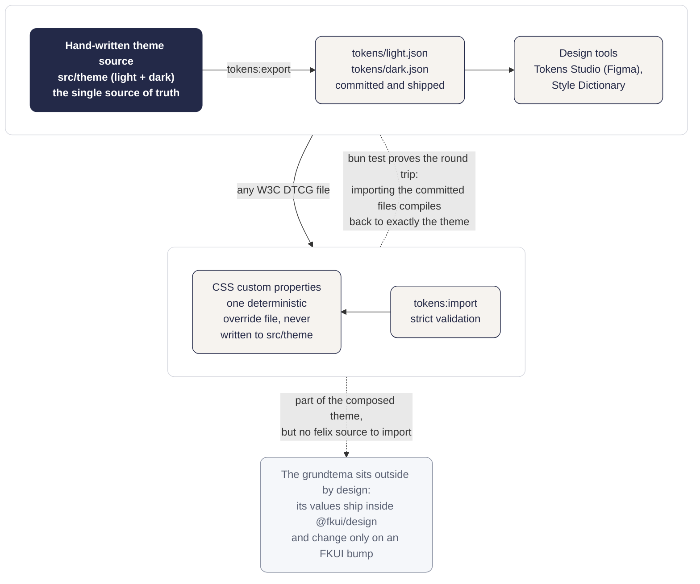

# Design tokens in DTCG format

*This document is also available in Swedish: [tokens.sv.md](tokens.sv.md).*

felix-ds ships the theme tokens as JSON in the [W3C Design Tokens](https://design-tokens.github.io/community-group/) draft format (DTCG). This makes the theme tokens readable to tooling outside the CSS world – among others Tokens Studio (Figma), Style Dictionary and documentation generators – without any hand copying.

Each direction has its own command: [export](#exporting-tokens) compiles the theme into `tokens/light.json` and `tokens/dark.json`, and [import](#importing-tokens) reads any DTCG file back into CSS custom properties.



## The files

The package contains two complete files, one per color mode:

- `@pattespatte/felix-ds/tokens/light.json`
- `@pattespatte/felix-ds/tokens/dark.json`

Each file is self-contained and contains the **composed theme** for its mode: the upstream `@fkui/theme-default` plus the felix profile's overrides, in other words exactly the values the theme mixins emit (see [the dark-mode section](getting-started.en.md#dark-mode)). Shared tokens (typography, borders, shadows) appear in both files. The files are committed to the repo and shipped with the npm package.

## Exporting tokens

To export the theme as DTCG, run:

```bash
bun run tokens:export
```

`tokens:export` is an alias of `tokens:build` – the two names run the same script, `scripts/tokens.ts`. The script compiles both color modes from the SCSS sources in `src/theme/`, types every value and writes `tokens/light.json` and `tokens/dark.json`. Those two files are the export; they are what gets committed and shipped with the package. The output is deterministic: sorted keys, 2-space indent, LF line endings and a trailing newline.

The direction is one-way. The hand-written SCSS in `src/theme/` remains the single source of truth, and the script never writes to it.

`bun test` guards the pair: the parity suite fails the committed files if they no longer match freshly compiled CSS – same name set, same values, valid structure, resolved aliases, nothing stale. After an FKUI upgrade, run `bun run fkui upgrade` and then `bun run tokens:export`, and review the diff: new tokens appear, and changed upstream values propagate into the export.

## Importing tokens

The import runs the other way: `scripts/tokens-import.ts` reads any W3C DTCG file and emits CSS custom properties. The typical source is an export from a design tool – Figma plugins that speak DTCG, for example – so a designer's token set becomes an override file without any hand copying:

```bash
bun run tokens:import -- design-tokens.json
bun run tokens:import -- design-tokens.json --out src/tokens.css
```

The first command reads `design-tokens.json`, validates it and prints the CSS to the terminal – useful for a quick look or for piping somewhere else. The second writes the CSS to `src/tokens.css` instead of printing it. Everything after the `--` belongs to the script: the first argument is the input file, `--out` names the output path, and without `--out` the CSS goes to standard output.

The scope is the felix theme's own variables only – the same surface the export describes. The grundtema is excluded by design: its values ship unmodified inside `@fkui/design`'s CSS, so there is no felix-ds source for them that an import could regenerate, and it changes only when the FKUI packages are bumped.

The output is deterministic: one `:root` block, declarations sorted by name, 2-space indent and a trailing newline. Aliases are emitted as `var(--target)` references, so the generated file refers to tokens instead of duplicating them. The name mapping is the mechanical inverse of the export's (see [the section on naming and grouping](#naming-and-grouping)).

Validation is strict, and every failure names the offending token path:

- the supported `$type` values are `color`, `dimension`, `number`, `duration`, `fontFamily` and `shadow` – anything else (e.g. `gradient` or `typography`) is rejected, because the felix token model cannot express it
- tokens without `$type` are accepted (composite shorthands, like the export's untyped tokens)
- every alias `{path}` must resolve to a token in the same file, and alias cycles are rejected
- mixed nodes (a token with child groups), empty groups, unknown `$`-keys and generated CSS-name collisions are rejected

The import never writes to the theme's own SCSS sources – the hand-written theme remains the single source of truth, and the importer is read-only over its input file. The round trip is proven by `bun test`: importing the committed `tokens/light.json` and `tokens/dark.json` compiles back to exactly the composed theme's declarations. One documented asymmetry: the export strips quotes from font names, so font lists are compared canonically rather than byte-for-byte, and re-emitted files reproduce value semantics rather than the original quoting choices.

## The format

The files follow the DTCG draft: tokens are objects with `$value` and optional `$type` and `$description`; groups are objects without `$value`. The following types are used:

| `$type` | Example |
| --- | --- |
| `color` | `#242946`, `rgba(0, 0, 0, 0.8)` |
| `dimension` | `3rem`, `1px`, `100%` |
| `duration` | `100ms` |
| `number` | `400` (font weight), `1.5` (line height) |
| `fontFamily` | `["Noto Sans", "system-ui", "sans-serif"]` |
| `shadow` | shadow object, see [the section on exclusions and deviations](#exclusions-and-deviations) |

DTCG is still a draft; the files are valid against the draft as of writing, but the format may change upstream.

## Naming and grouping

The CSS custom-property name maps mechanically: the name without the leading `--` splits on hyphens into a nested path, and conversely the path segments join back with hyphens:

- `--fkds-color-action-text-primary-default` → `fkds.color.action.text.primary.default`
- `--f-font-size-xxx-large` → `f.font.size.xxx.large`
- `f.font.size.xxx.large` → `--f-font-size-xxx-large`

When a token's name is a strict prefix of another (`--f-font-family` before `--f-font-family-code`), the name cannot be both a leaf and a group at once – DTCG consumers would then see the subgroups as invisible extra properties. The shorter name is therefore nested under the reserved segment `_self` (the name vocabulary never contains underscores, so the rule is unambiguous in both directions):

```json
"warning": {
    "_self": {
        "$type": "color",
        "$value": "#fff3c6"
    },
    "strong": {
        "$type": "color",
        "$value": "#ffc108"
    }
}
```

This corresponds to `--fkds-color-feedback-background-warning` and `--fkds-color-feedback-background-warning-strong`. The round trip is mechanical: join the segments with hyphens and drop `_self`. Nine tokens are affected (the font family, the button shadow with subtokens, the five `strong` variants and the focus ring colors).

## Alias references

Tokens that point at another token in CSS are expressed as DTCG aliases `{path}` (no dollar sign – `$` is reserved for property names like `$value`):

- `--f-page-layout-background` → `"{fkds.color.background.tertiary}"` (both modes)
- `--f-color-focus` → `"{fkds.focus.indicator.color._self}"`
- `--f-tooltip-border-width` → `"{f.border.width.medium}"`
- The focus indicator's shadow consists of two rings whose colors are aliases: `"{fkds.focus.indicator.color.background}"` and `"{fkds.focus.indicator.color._self}"`.

All aliases resolve within the same file.

## Surfaces in two pairs

The light mode background values form two pairs, both read with the same dark foreground (`fkds.color.text.primary`):

| Surface | Token | Value | Used for |
| --- | --- | --- | --- |
| Cool ground | `fkds.color.background.secondary` | `#f5f7fa` | The page's base surface |
| Cool surface | `fkds.color.background.primary` | `#ffffff` | Cards, fields and popovers lifted off the ground |
| Warm ground | `fkds.color.background.tertiary` | `#f6f3ef` | Soft bands, such as side panels |
| Warm surface | `fkds.color.background.warm` | `#dfd7c8` | Deeper sand bands |

The warm pair belongs with the dark foreground. White text does not — the contrast against `#dfd7c8` is too low. Dark mode keeps its own neutral ramp instead of mirroring the pairs, so `background.warm` takes a neutral value there.

Primary background stays white and must not be repainted in the ground colour: upstream binds some thirty component surfaces — cards, fields, table rows, popovers — to that token, so cards and fields would vanish into the ground.

## Exclusions and deviations

The export mirrors the theme 1:1 except for the following, all documented decisions:

1. **The logo placeholders `--f-logo-image-small`/`--f-logo-image-large`** are not included. Their `url()` data URIs have no natural DTCG type. They reach consumers as usual via the CSS custom properties.
2. **`--fkui-theme-default-version`** is not included. It is the upstream package's version metadata, not a design token.
3. **26 tokens have no `$type`.** Their values are composite CSS shorthands or keywords without a DTCG equivalent: the heading colors (`f.text.color.heading.1`–`6`, value `inherit`), the buttons' reset paddings (`initial`), the `ease-out` animation curve, multi-part margins/sizes (e.g. `padding.input.fields`, `f.modal.close.button.margin`), the transition shorthands (`f.animation.expand.open`/`close`) and `none` on non-shadow properties (`f.button.discrete.radius.hover`, `f.modal.close.button.padding`). `$value` is the exact CSS value; `$type` is deliberately omitted rather than pretending to a wrong type. A strict DTCG validator flags these as warnings (missing `$type`) – expected and documented.
4. **`"none"` shadows are kept.** The profile is completely flat, so shadow tokens with value `none` (`f.button.shadow` with subtokens, `f.box.modal.shadow`, `f.input.shadow.inset`) are emitted as `$type: "shadow"` with `$value: "none"` – removing them would hide a design decision. A strict validator flags the value itself (expected warning); consumers that cannot interpret `"none"` may skip these tokens.

## Consuming the tokens

**As JSON** (Node/Bun; a conditional alias resolver is simple):

```ts
import light from "@pattespatte/felix-ds/tokens/light.json";

const primary = light.fkds.color.text.primary.$value; // "#242946"
```

**With Style Dictionary** (illustration, not part of the package):

```js
export default {
    source: ["node_modules/@pattespatte/felix-ds/tokens/light.json"],
    platforms: {
        css: {
            transformGroup: "css",
            files: [{ destination: "tokens.css", format: "css/variables" }],
        },
    },
};
```

**In Tokens Studio:** import the file as a token set (DTCG format).
